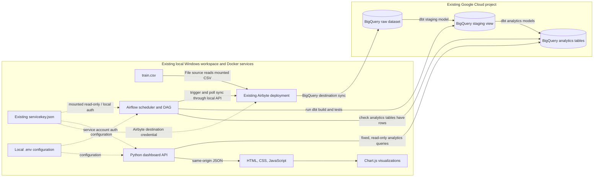
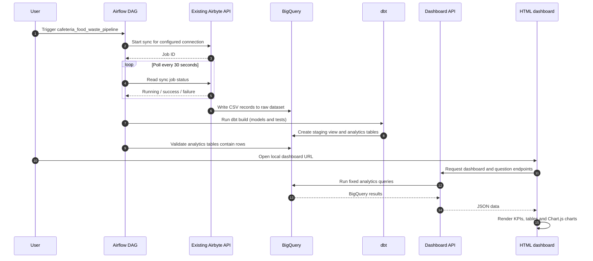

# Cafeteria Food Waste Analytics

A local data engineering project that loads the workspace CSV through the existing self-hosted Airbyte deployment, stores raw and transformed data in BigQuery, schedules ingestion and dbt with Airflow, and presents live analytics in a standalone HTML dashboard. The dashboard uses a small Python HTTP API to query BigQuery; credentials stay on the server and are never sent to the browser.

This project reports observed food waste. It does not make forecasts or generate synthetic dashboard data.

## Contents

- [Architecture](#architecture)
- [Project layout](#project-layout)
- [Prerequisites](#prerequisites)
- [Configuration and credentials](#configuration-and-credentials)
- [One-time setup](#one-time-setup)
- [Configure the existing Airbyte connection](#configure-the-existing-airbyte-connection)
- [Run the pipeline](#run-the-pipeline)
- [Run the HTML dashboard](#run-the-html-dashboard)
- [Tests and validation](#tests-and-validation)
- [Data model and cleaning](#data-model-and-cleaning)
- [Troubleshooting](#troubleshooting)
- [Security notes](#security-notes)

## Architecture

### System architecture



The Airflow deployment is defined in `docker/airflow/docker-compose.yml`; it does not define or replace Airbyte. Continue using the Airbyte deployment that is already running. BigQuery is the only warehouse. The HTML files are served by the Python API, which returns JSON from fixed query templates. The browser does not receive the service account key and cannot submit arbitrary SQL.

### Pipeline execution sequence



## Project layout

```text
.
├── airflow/
│   └── dags/                       # Airbyte API helper and pipeline DAG
├── backend/
│   ├── queries.py                  # Fixed BigQuery queries and JSON conversion
│   └── server.py                   # Local HTML server and JSON API
├── config/
│   └── profiles.yml.example        # dbt BigQuery profile template
├── dbt/
│   ├── models/staging/             # Cleaned BigQuery staging view
│   ├── models/analytics/           # Daily, category and monthly summaries
│   └── tests/                      # Data quality assertions
├── docker/airflow/
│   ├── Dockerfile
│   └── docker-compose.yml          # Airflow only; does not manage Airbyte
├── frontend/
│   ├── index.html
│   ├── styles.css
│   └── app.js
├── scripts/inspect_dataset.py      # Local CSV inspection utility
├── tests/                          # Python unit tests
├── train.csv                       # Input dataset; left unchanged
├── servicekey.json                 # Existing credential; ignored by Git
├── .env.example                    # Safe configuration template
├── requirements.txt
└── README.md
```

## Prerequisites

- Windows 10/11, PowerShell, and VS Code (optional).
- The existing `.venv` in the project root. Do not create another environment.
- The existing `servicekey.json` in the project root. Do not copy, rename, overwrite, or commit it.
- An existing Google Cloud project with BigQuery enabled and access granted to the service account in that key.
- The existing locally hosted Airbyte deployment and a configured source/destination connection, or the ability to configure that connection in its UI.
- Docker Desktop only for the Airflow service described in this guide. This repository's Compose file does not install or control Airbyte.
- Internet access when installing Python packages, pulling the Airflow base image manually, or loading Chart.js from its CDN in the browser.

The current workspace virtual environment is Python 3.14. The standalone dashboard, tests, and CSV inspection run in that environment. The project pins dbt 1.9, so dbt runs in the Airflow image's Python 3.11 environment rather than the workspace Python 3.14 environment.

## Configuration and credentials

Copy `.env.example` to `.env` and fill in the values for your existing services. `.env` is ignored by Git. Do not paste private keys or credentials into README, source files, issue trackers, or logs.

| Variable | Purpose |
|---|---|
| `GCP_PROJECT_ID` | Existing Google Cloud project ID (not its display name). |
| `GOOGLE_APPLICATION_CREDENTIALS` | Existing local key path; keep `./servicekey.json`. Compose overrides this with its read-only container mount. |
| `BIGQUERY_LOCATION` | Location shared by the raw, staging, and analytics datasets (for example, `US`). |
| `BIGQUERY_RAW_DATASET` | BigQuery dataset written by Airbyte; default `food_waste_raw`. |
| `BIGQUERY_STAGING_DATASET` | dbt cleaned view dataset; default `food_waste_staging`. |
| `BIGQUERY_ANALYTICS_DATASET` | dbt dashboard tables dataset; default `food_waste_analytics`. |
| `BIGQUERY_RAW_TABLE` | Airbyte output table and dbt source; default `food_waste_records`. |
| `DBT_BIGQUERY_METHOD` | Set to `service-account` to use the existing key. |
| `DBT_BIGQUERY_KEYFILE` | Keep `./servicekey.json`; the Airflow container uses `/run/secrets/servicekey.json`. |
| `AIRBYTE_API_URL` | Airbyte API base URL reachable from Airflow. For host Airbyte, the example uses `http://host.docker.internal:8000/api/public/v1`. |
| `AIRBYTE_CONNECTION_ID` | UUID of the existing Airbyte connection that syncs this dataset. |
| `AIRBYTE_API_CLIENT_ID` and `AIRBYTE_API_CLIENT_SECRET` | Existing Airbyte API application credentials, if the local deployment requires authentication. |
| `AIRBYTE_API_TOKEN` | Optional existing bearer token fallback. Leave blank when using client ID/secret. |
| `DASHBOARD_HOST` | Local dashboard bind address; keep `127.0.0.1` for local-only access. |
| `DASHBOARD_PORT` | Dashboard port; default `8501`. Change it if that port is in use. |

The same existing service account is used for the local dashboard API and dbt. Select that existing key in Airbyte's secure BigQuery destination setup. Airbyte keeps its destination credential in Airbyte configuration; do not expose key contents in `.env`.

## One-time setup

### 1. Activate the existing venv and install workspace packages

Run from the project root in PowerShell:

```powershell
Set-ExecutionPolicy -Scope Process -ExecutionPolicy Bypass
.\.venv\Scripts\Activate.ps1
python --version
python -m pip install -r requirements.txt
```

Do not run `python -m venv` or create another venv. The frontend is plain HTML, CSS, and JavaScript; Chart.js is loaded from the pinned CDN URL in `frontend/index.html`. The Python package requirements are for the BigQuery API, configuration, and local validation.

### 2. Create the ignored `.env` configuration

```powershell
Copy-Item .env.example .env
notepad .env
```

Set the existing project ID, dataset IDs, Airbyte connection ID, and any existing Airbyte API authentication values. Retain `GOOGLE_APPLICATION_CREDENTIALS=./servicekey.json`, `DBT_BIGQUERY_METHOD=service-account`, and `DBT_BIGQUERY_KEYFILE=./servicekey.json`. Do not put the JSON key contents into `.env`.

### 3. Prepare the dbt profiles

The profile template references environment variables, not literal secrets. dbt in Airflow uses the mounted copy at `/home/airflow/.dbt/profiles.yml`; the local copy is available for supported Python versions.

```powershell
New-Item -ItemType Directory -Force "$env:USERPROFILE\.dbt"
Copy-Item config/profiles.yml.example "$env:USERPROFILE\.dbt\profiles.yml"
Copy-Item config/profiles.yml.example config/profiles.yml
```

`config/profiles.yml` is ignored by Git. It is mounted read-only into Airflow. If updating the profile template later, refresh both copies.

### 4. Verify the existing BigQuery setup

1. Use the existing Google Cloud project associated with `servicekey.json`; put only its project ID in `.env`.
2. Confirm the BigQuery API is enabled in that project.
3. Confirm these datasets exist in the same BigQuery location: raw (`food_waste_raw`), staging (`food_waste_staging`), and analytics (`food_waste_analytics`). If your IDs differ, update `.env` consistently.
4. Confirm the service account already in `servicekey.json` has BigQuery Job User on the project and sufficient data permissions on the datasets. Ask the project administrator to grant missing permissions to that existing account; do not create another service account or download another key.
5. Ensure the account can create/replace the staging view and analytics tables used by dbt.

## Configure the existing Airbyte connection

Use your current self-hosted Airbyte UI and deployment. Do not install another Airbyte instance. The Airbyte File source reads a path visible inside the Airbyte source worker, so the workspace CSV must be available through the deployment's existing local filesystem mount.

1. In the existing Airbyte UI, inspect Sources, Destinations, and Connections. Reuse an existing File/CSV source, BigQuery destination, and connection if they already match the project.
2. If a File source is needed, configure the File connector with dataset name `food_waste_records`, CSV format, local filesystem storage, and the worker-visible file URL (commonly `/local/train.csv`). Confirm the Airbyte worker can actually read that mounted file and that discovery finds the expected 12 columns.
3. If the BigQuery destination needs configuration, select the existing `servicekey.json` through Airbyte's secure credential field. Set the existing project ID, BigQuery location, raw dataset, and output table `food_waste_records`. Do not copy credential contents into project files.
4. Connect the source and destination. Use the raw dataset namespace and, for this static CSV snapshot, `Full Refresh | Overwrite`. Run one manual sync from Airbyte and confirm that `food_waste_raw.food_waste_records` (or your configured equivalent) contains rows.
5. Copy the existing connection UUID into `AIRBYTE_CONNECTION_ID` in `.env`.
6. Confirm the local Airbyte API base URL and whether authentication is enabled. For the documented local setup, Airflow reaches a host service through `http://host.docker.internal:8000/api/public/v1`; use the actual URL and port for your deployment. If authentication is enabled, provide an existing API application's client ID and secret, or a valid configured bearer token. The DAG requests a short-lived token when client ID/secret are supplied.

The Airbyte API on this workspace was not reachable during project implementation. Confirm the existing deployment's API URL, auth settings, worker file mount, and connection ID in your own running Airbyte UI before starting the scheduled pipeline. The project does not invent these instance-specific values.

## Run the pipeline

> The following Docker commands are instructions for you to run manually. This project setup does not run Docker commands on your behalf. The Compose file here defines Airflow only; keep your current Airbyte deployment as-is.

### 1. Start Airflow

Make sure `.env`, `config/profiles.yml`, and the existing `servicekey.json` are in place. Start Docker Desktop manually, then run these commands from the project root:

```powershell
docker compose -f docker/airflow/docker-compose.yml build
docker compose -f docker/airflow/docker-compose.yml up -d
docker compose -f docker/airflow/docker-compose.yml ps
```

The Compose service runs Airflow standalone on port 8080, mounts the DAGs and dbt project, mounts the dbt profile read-only, and mounts the existing service key read-only. It does not create, restart, or manage Airbyte.

Open [http://localhost:8080](http://localhost:8080). The standalone Airflow login is generated by Airflow and printed in its startup logs:

```powershell
docker compose -f docker/airflow/docker-compose.yml logs airflow
```

Sign in, unpause `cafeteria_food_waste_pipeline` if it is paused, and select **Trigger DAG**. Inspect the Grid/Graph view and task logs. Expected task order:

1. `trigger_airbyte_sync` starts the configured Airbyte connection.
2. `wait_for_airbyte_sync` polls until the Airbyte job succeeds or fails.
3. `dbt_build` builds staging and analytics models and executes dbt tests.
4. `validate_analytics_tables` confirms all three analytics tables have rows.

The DAG is scheduled daily, has catchup disabled, and can also be triggered manually. It retries failed tasks twice. A successful DAG run is needed before the dashboard can load analytics tables.

### 2. Optional dbt commands inside the running Airflow container

The workspace venv is Python 3.14, while the pinned dbt 1.9 packages run in the Airflow image's Python 3.11 dbt environment. Do not use the local venv for these dbt commands. From the project root, run the following manually after Airflow is up:

```powershell
docker compose -f docker/airflow/docker-compose.yml exec airflow dbt debug --project-dir /opt/food-waste/dbt --profiles-dir /home/airflow/.dbt
docker compose -f docker/airflow/docker-compose.yml exec airflow dbt build --project-dir /opt/food-waste/dbt --profiles-dir /home/airflow/.dbt
```

`dbt build` is normally run by the DAG; these commands are useful for diagnosing the connection or manually rebuilding models.

## Run the HTML dashboard

After the DAG completes successfully, open a separate PowerShell window in the project root, activate the existing venv, and start the local server:

```powershell
.\.venv\Scripts\Activate.ps1
python -m backend.server
```

Open [http://127.0.0.1:8501](http://127.0.0.1:8501). The API reads `.env`, authenticates to BigQuery with the existing `servicekey.json`, serves the files in `frontend/`, and exposes these same-origin endpoints:

| Endpoint | Purpose |
|---|---|
| `/api/health` | Local API health check; does not query BigQuery. |
| `/api/questions` | Lists the supported analytics questions. |
| `/api/dashboard` | Returns live KPI, daily, category, and monthly analytics rows. |
| `/api/question?id=highest_category` | Runs a supported predefined question query. |

The dashboard includes KPI cards, daily and monthly trends, category distribution, a recent daily table, and a question panel with query results and SQL details. It uses real BigQuery analytics tables, not mock data. If port 8501 is occupied, set `DASHBOARD_PORT=8503` (or another free port) in `.env`, restart the API, and open the matching `http://127.0.0.1:<port>` address. Press **Ctrl+C** in the dashboard PowerShell window to stop the API.

## Tests and validation

With the existing venv activated, run from the project root:

```powershell
python scripts/inspect_dataset.py
python -m unittest discover -s tests -v
python -m pip check
```

The unit suite covers dataset shape and inspection, Airbyte API request behavior using mocks, fixed BigQuery query selection, BigQuery value-to-JSON conversion, and frontend/API source expectations. Unit tests do not trigger Airbyte or write to BigQuery. End-to-end validation requires the existing Airbyte API, service account permissions, BigQuery datasets, and a successful Airflow DAG run.

Useful manual checks:

```powershell
Invoke-RestMethod http://127.0.0.1:8501/api/health
Invoke-RestMethod http://127.0.0.1:8501/api/questions
```

Use the actual dashboard port in those URLs if `DASHBOARD_PORT` was changed.

## Data model and cleaning

The source `train.csv` contains 911 records and 12 columns. It is kept unchanged. It contains a source ID, date, meals and staffing counts, temperature and humidity readings, weekday and special-event fields, past waste, staff experience, waste category, and measured `food_waste_kg`.

| Layer | Model/table | Materialization | Role |
|---|---|---|---|
| Raw | `food_waste_raw.food_waste_records` | Airbyte destination table | Landing copy of source CSV. |
| Staging | `food_waste_staging.stg_food_waste` | View | Safe casts, normalized known category/experience casing, sentinel handling, deduplication, and required-field filtering. |
| Analytics | `food_waste_analytics.daily_waste_summary` | Table | Daily totals and descriptive measures used by the dashboard. |
| Analytics | `food_waste_analytics.category_waste_summary` | Table | Waste totals and shares by category. |
| Analytics | `food_waste_analytics.monthly_waste_summary` | Table | Monthly observed waste totals. |

The CSV inspection found 12 expected fields, no empty cells, no exact duplicate rows, and unique IDs. Some category and experience values have inconsistent casing; `staff_experience` has 164 `nan` sentinels. dbt uses `SAFE_CAST`, normalizes known values, maps missing categorical sentinels to `Unknown`, deduplicates by ID, and filters invalid required IDs/dates or missing/negative measured waste. Valid measured `food_waste_kg` is preserved. Waste is not imputed or capped, and no forecast is calculated.

The source date range is 2022-01-01 through 2024-09-26. The observed ranges include meals served 100-4730, temperature -10.37 to 60 C, humidity 30.12-89.98%, and measured food waste 10.82-274.33 kg. These are descriptions of the supplied source data, not validation limits imposed on the dashboard.

## Troubleshooting

| Symptom | Checks |
|---|---|
| Airbyte File source cannot read `/local/train.csv` | Confirm that the existing Airbyte worker can see the host CSV through its configured local mount. A Windows workspace path is not automatically visible inside a container. Check connector logs and the source URL. |
| Airbyte API returns 401 | Check the API base URL, whether auth is enabled, the existing client ID/secret, and Airbyte API application permissions. Do not use an expired bearer token. |
| Airbyte sync fails | Inspect the Airbyte connection job log, destination credential configuration, raw dataset location, table/namespace, and service account permissions. |
| dbt reports that its source table is missing | Confirm a successful sync created the configured raw dataset/table and that `BIGQUERY_RAW_DATASET` and `BIGQUERY_RAW_TABLE` match. |
| dbt authentication or permission error | Check project ID, BigQuery API enablement, dataset location, profile mount, key path, and permissions for the existing service account. |
| Airflow cannot reach Airbyte | From the Airflow container, `localhost` points at that container. Use the host-reachable Airbyte URL (commonly `host.docker.internal`) and verify the actual local API port. |
| Airflow cannot find the profile/key | Ensure `config/profiles.yml` and `servicekey.json` exist at the workspace root and the Compose bind mounts resolve. The container key path is `/run/secrets/servicekey.json`. |
| DAG succeeds but dashboard analytics are empty | Confirm the DAG's analytics validation passed and the `.env` project, location, and analytics dataset match dbt's output. |
| Dashboard reports BigQuery analytics unavailable | Verify `.env`, service key readability, service account permissions, and that all analytics tables exist and contain rows. The API logs exception types, not credentials or exception contents. |
| Charts are blank but tables load | Check browser connectivity to the pinned Chart.js CDN script and the browser console, then refresh. |
| Dashboard port is in use | Set `DASHBOARD_PORT` in `.env` to an available port, restart `python -m backend.server`, and open that port. |
| PowerShell blocks venv activation | Run `Set-ExecutionPolicy -Scope Process -ExecutionPolicy Bypass` in that PowerShell session, then activate `.venv`. |

## Security notes

- `.env`, `config/profiles.yml`, `servicekey.json`, and runtime/cache files are excluded from Git.
- Keep the existing service account key at the workspace root. Never paste its contents into source, `.env`, README, or logs.
- The Airflow Compose configuration mounts the key read-only. The dashboard binds to `127.0.0.1` by default; do not expose this development API to an untrusted network.
- The dashboard API supports fixed query IDs and does not accept arbitrary SQL. Avoid forwarding raw stack traces or credential values to the browser.
- Do not use real service credentials in screenshots, source control, or issue reports.

## Stop services

Stop the dashboard with **Ctrl+C** in its PowerShell window. To stop this project's Airflow service manually while preserving its persisted state, run from the project root:

```powershell
docker compose -f docker/airflow/docker-compose.yml down
```

That command applies only to the Airflow Compose project. Leave the pre-existing Airbyte deployment running unless you separately choose to manage it.
