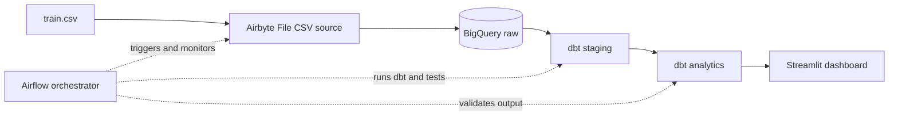

# Cafeteria Food Waste Monitoring and Analytics

This runbook explains the complete setup from the existing workspace through a verified dashboard. The pipeline uses Airbyte to load the supplied CSV, BigQuery for the warehouse, dbt SQL for transformations, Airflow for orchestration, and Streamlit for the manager dashboard. It analyzes observed food waste; it does not train models or forecast.

## Before you start

You need:

- Windows 10/11, VS Code, PowerShell, and the existing workspace virtual environment at .venv.
- Python is already in that venv. It is Python 3.14.7 in this workspace.
- Docker Desktop installed and running when you start Airbyte/Airflow.
- Access to the existing Google Cloud project, BigQuery datasets, and the existing workspace servicekey.json.
- The existing self-hosted local Airbyte deployment.
- Network access for package downloads and Docker image pulls.

The original train.csv stays at the workspace root and is never edited. Inspection found 911 records and 12 expected fields, no empty cells, no exact duplicate rows, and unique IDs. Some category/experience values have inconsistent casing; staff_experience contains 164 "nan" sentinels. See the Dataset section below.

## Architecture



Airbyte performs ingestion, dbt performs SQL transformations, BigQuery stores raw and modeled data, Airflow coordinates the steps, and Streamlit reads only transformed tables.

## Project files

```text
train.csv
airflow/dags/airbyte_api.py
airflow/dags/cafeteria_food_waste_pipeline.py
airflow/requirements.txt
dbt/dbt_project.yml
dbt/models/sources.yml
dbt/models/staging/
dbt/models/analytics/
dbt/tests/
streamlit/app.py
streamlit/components/
streamlit/queries/
streamlit/utils/
scripts/inspect_dataset.py
tests/
config/profiles.yml.example
docker/airflow/Dockerfile
docker/airflow/docker-compose.yml
.env.example
.gitignore
requirements.txt
README.md
```

## Credentials and configuration checklist

You will configure these values in a local .env file. It is ignored by Git.

| Variable | Where to get it / what it controls |
|---|---|
| GCP_PROJECT_ID | Google Cloud Console project ID, not its display name |
| GOOGLE_APPLICATION_CREDENTIALS | ./servicekey.json, the existing workspace credential file |
| BIGQUERY_LOCATION | BigQuery dataset location, for example US; all three datasets must match |
| BIGQUERY_RAW_DATASET | Dataset Airbyte writes; default food_waste_raw |
| BIGQUERY_STAGING_DATASET | dbt cleaned view dataset; default food_waste_staging |
| BIGQUERY_ANALYTICS_DATASET | dbt summary table dataset; default food_waste_analytics |
| BIGQUERY_RAW_TABLE | Airbyte output table and dbt source identifier; default food_waste_records |
| AIRBYTE_API_URL | Airbyte API reachable from the Airflow container; local default is http://host.docker.internal:8000/api/public/v1 |
| AIRBYTE_API_CLIENT_ID | Existing local Airbyte API application client ID, if authentication is enabled |
| AIRBYTE_API_CLIENT_SECRET | Matching existing local Airbyte client secret; keep it private |
| AIRBYTE_API_TOKEN | Optional fallback token; leave blank when using client ID/secret |
| AIRBYTE_CONNECTION_ID | UUID from the Airbyte connection page/address bar |
| DBT_BIGQUERY_METHOD | service-account for the documented setup |
| DBT_BIGQUERY_KEYFILE | ./servicekey.json locally; Compose uses the container mount |

The existing servicekey.json is reused by local Streamlit, dbt, Airflow, and Airbyte's BigQuery destination. The file is not read into this documentation, copied, renamed, or moved. Airbyte stores its destination credential in its own connection configuration. Do not put JSON contents in .env or source code.

## 1. Activate the existing environment and install packages

Open PowerShell in the project root:

```powershell
Set-ExecutionPolicy -Scope Process -ExecutionPolicy Bypass
.\.venv\Scripts\Activate.ps1
python --version
python -m pip install -r requirements.txt
```

Do not create another venv. requirements.txt installs Streamlit, BigQuery client/authentication, pandas, dbt Core, and dbt-bigquery into this existing venv. The separate Airflow image installs the dependencies in airflow/requirements.txt.

The local venv is Python 3.14.7. The pinned dbt 1.9 adapter is not compatible with Python 3.14, so run dbt in the provided Airflow Python 3.11 container as described below. Streamlit, the CSV inspection utility, and the unit tests can use the existing venv.

## 2. Create the local environment file

```powershell
Copy-Item .env.example .env
notepad .env
```

Fill the project, dataset, and existing Airbyte connection values. Keep .env private. Leave GOOGLE_APPLICATION_CREDENTIALS and DBT_BIGQUERY_KEYFILE as ./servicekey.json; it points at the credential file already in this workspace.

The profile template reads environment variables. Make the standard local dbt profile and the separate read-only Airflow profile mount:

```powershell
New-Item -ItemType Directory -Force "$env:USERPROFILE\.dbt"
Copy-Item config/profiles.yml.example "$env:USERPROFILE\.dbt\profiles.yml"
Copy-Item config/profiles.yml.example config/profiles.yml
```

config/profiles.yml is git-ignored. It contains only environment-variable references, not secrets.

## 3. Set up Google Cloud and BigQuery

1. Use the Google Cloud project and service account that correspond to the existing servicekey.json. Copy only the project ID into GCP_PROJECT_ID.
2. Confirm the BigQuery API is enabled for that project.
3. Confirm food_waste_raw, food_waste_staging, and food_waste_analytics exist in the same location. Create only any missing datasets in the existing project, and set their IDs/location in .env.
4. Confirm the existing service account has BigQuery Job User at project level and BigQuery Data Editor on these datasets. If permissions are missing, ask the project administrator to grant them to the existing account. Do not create another service account or download another key.
5. Set GOOGLE_APPLICATION_CREDENTIALS=./servicekey.json, DBT_BIGQUERY_METHOD=service-account, and DBT_BIGQUERY_KEYFILE=./servicekey.json.

The raw dataset is the Airbyte landing zone. dbt creates a cleaned staging view and the analytics tables. The dbt project uses the project ID, datasets, raw table, and existing credential file from environment variables.

## 4. Set up Airbyte and give it the CSV

Use the existing local, self-hosted Airbyte deployment. Do not install or recreate it. The official [File connector guide](https://docs.airbyte.com/integrations/sources/file) describes the local mount and source fields. The [Airbyte API docs](https://docs.airbyte.com/developers/api-documentation) describe the self-managed API base URL and authentication.

The usual local API base URL is http://localhost:8000/api/public/v1. From inside the Airflow container, use http://host.docker.internal:8000/api/public/v1. If your existing deployment uses another host or port, use its configured URL. The local API ports were not reachable from this implementation session, and there was no Airbyte configuration file in the workspace, so confirm the URL and connection ID in your running Airbyte UI.

### Reuse the existing connection or configure it in the existing Airbyte UI

1. Open the already running Airbyte UI and look for a File/CSV source, BigQuery destination, and connection. Reuse them if present; do not restart Airbyte.
2. If a source is still needed, use the File connector with Dataset Name food_waste_records, File Format CSV, Storage Provider Local Filesystem, and URL /local/train.csv. Verify the source worker can read the workspace CSV through its existing local mount and that schema discovery shows the 12 expected columns.
3. If the BigQuery destination is not configured, set its project ID, BigQuery location, and raw dataset food_waste_raw. Select the existing workspace credential file servicekey.json in Airbyte's secure credential field. Do not copy its contents into project files or logs.
4. Connect the source to that BigQuery destination. Set destination namespace to food_waste_raw and output table to food_waste_records. Use Full Refresh | Overwrite for this static CSV. Run Sync Now once and verify the raw table in BigQuery.
5. Copy the existing connection UUID from its Airbyte details/address bar into AIRBYTE_CONNECTION_ID in .env.
6. Copy the connection UUID into AIRBYTE_CONNECTION_ID in .env. If API authentication is enabled, reuse the existing application client ID/secret from the local Airbyte user's Settings > Account > Applications. If the deployment requires authentication and no API application exists, create one in that existing Airbyte instance; do not reinstall Airbyte. If API authentication is disabled, leave the client ID/secret blank. The Airflow integration requests a short-lived token for each API call.

This project does not start, stop, upgrade, or recreate Airbyte. It only calls the configured API to trigger and poll the selected connection.

## 5. Configure and run dbt

The dbt profile must be in the standard user profile directory at %USERPROFILE%\.dbt\profiles.yml. dbt itself does not automatically read .env. The following dotenv command loads the workspace .env for each local dbt command:

```powershell
python -m dotenv run -- dbt debug --project-dir dbt --profiles-dir "$env:USERPROFILE\.dbt"
python -m dotenv run -- dbt run --project-dir dbt --profiles-dir "$env:USERPROFILE\.dbt"
python -m dotenv run -- dbt test --project-dir dbt --profiles-dir "$env:USERPROFILE\.dbt"
python -m dotenv run -- dbt build --project-dir dbt --profiles-dir "$env:USERPROFILE\.dbt"
```

Those local dbt commands require a Python version supported by dbt 1.9. The existing venv is Python 3.14, so use the Airflow container commands below for this workspace instead.

Models:
- staging: stg_food_waste, a view with standardized categories/experience, safe casts, and duplicate handling.
- analytics: daily_waste_summary, category_waste_summary, monthly_waste_summary.
- tests: identifier uniqueness/not-null, date and measured-waste not-null, accepted category/experience values, and numeric/flag ranges.

Valid measured food_waste_kg is preserved; the project does not impute or cap observed waste.

## 6. Build and start Airflow (Docker commands)

Before Compose starts, ensure .env is filled in and config/profiles.yml exists. Docker Desktop must be running. Run each command below from the project root (the folder containing docker/airflow/docker-compose.yml).

```powershell
docker compose -f docker/airflow/docker-compose.yml build
docker compose -f docker/airflow/docker-compose.yml up -d
docker compose -f docker/airflow/docker-compose.yml ps
```

- build creates the Airflow image with Airflow, dbt-bigquery, BigQuery client, and the DAG runtime packages.
- up -d starts the Airflow standalone scheduler and web UI on port 8080.
- ps shows whether the Airflow container is running.

Open http://localhost:8080. The initial Airflow username/password are printed by:

```powershell
docker compose -f docker/airflow/docker-compose.yml logs airflow
```

Find the generated standalone login in the startup log. In the UI, unpause cafeteria_food_waste_pipeline and click Trigger DAG. Open Grid or Graph and inspect task logs. Expected sequence: Airbyte trigger, wait for successful sync, dbt build (models and tests), BigQuery analytics-table validation.

The Airflow task runs dbt in Python 3.11 and reads its mounted profile from /home/airflow/.dbt. To manually run a dbt command in the already running container, use these commands from the project root:

```powershell
docker compose -f docker/airflow/docker-compose.yml exec airflow dbt debug --project-dir /opt/food-waste/dbt --profiles-dir /home/airflow/.dbt
docker compose -f docker/airflow/docker-compose.yml exec airflow dbt run --project-dir /opt/food-waste/dbt --profiles-dir /home/airflow/.dbt
docker compose -f docker/airflow/docker-compose.yml exec airflow dbt test --project-dir /opt/food-waste/dbt --profiles-dir /home/airflow/.dbt
docker compose -f docker/airflow/docker-compose.yml exec airflow dbt build --project-dir /opt/food-waste/dbt --profiles-dir /home/airflow/.dbt
```

The DAG normally runs dbt build for you; manual commands are for checking dbt or running it outside a DAG run.

## 7. Start Streamlit

After a successful DAG run, return to PowerShell in the project root with .venv activated:

```powershell
streamlit run streamlit/app.py
```

Open http://localhost:8501. Streamlit loads .env and authenticates to BigQuery with GOOGLE_APPLICATION_CREDENTIALS. The dashboard displays total waste, meals, weighted waste per meal, category count, daily trend, category distribution, and monthly trend. The chat screen accepts the six listed questions exactly, shows the generated predefined SQL, and queries only dbt analytics tables. Arbitrary user-entered SQL is never executed. To use another port, add --server.port PORT to the Streamlit command.

To stop Streamlit, press Ctrl+C in its PowerShell window.

## 8. Verify the project

Run local checks from the project root with .venv active:

```powershell
python scripts/inspect_dataset.py
python -m unittest discover -s tests -v
```

The tests cover the actual CSV schema/counts, mock the Airbyte API, mock BigQuery query execution, and start the Streamlit page without cloud credentials. Cloud sync, BigQuery execution, dbt build, and Airflow execution require your configured accounts/services; they were not run in this workspace.

## Complete run order checklist

1. Start Docker Desktop.
2. Activate the existing .venv and install requirements.txt.
3. Copy .env.example to .env; create the user dbt profile and the ignored Compose profile copy.
4. Use the existing Google Cloud project and servicekey.json. Confirm BigQuery API, datasets, and existing service-account permissions; fill project/dataset values in .env.
5. Open the already running local Airbyte instance. Reuse its File source, BigQuery destination, and connection if configured. Select the existing servicekey.json for the destination, verify the local CSV source/mount, run one sync, and fill in the existing connection ID and API credentials if authentication is enabled.
6. From the project root, build/start Airflow with the Docker Compose commands.
7. Open Airflow, trigger the DAG, monitor tasks, and verify all analytics tables contain rows.
8. Start Streamlit and review the dashboard/chat questions.
9. When finished, stop Airflow. Leave the existing Airbyte deployment running.

To stop the Airflow container while keeping its persisted state:

```powershell
docker compose -f docker/airflow/docker-compose.yml down
```

Leave the existing Airbyte deployment running. This project does not stop or uninstall it.

## Dataset details and cleaning

The source contains 12 columns:
- ID: source record identifier.
- date: observation date.
- meals_served and kitchen_staff: meal and staffing counts.
- temperature_C and humidity_percent: environmental readings.
- day_of_week and special_event: source weekday code and event flag.
- past_waste_kg: supplied historical waste field.
- staff_experience and waste_category: categorical values.
- food_waste_kg: actual measured waste used by the summaries.

CSV fields are text. The inspection utility reports physical CSV types, inferred logical types, missing/sentinel values, invalid numeric/date values, duplicates, category frequencies, and numeric ranges. The source date range is 2022-01-01 to 2024-09-26. Observed ranges include meals 100-4730, temperature -10.37 to 60 C, humidity 30.12-89.98%, and food waste 10.82-274.33 kg. Observed extremes are not clipped. dbt uses SAFE_CAST, normalizes known category/experience casing, maps missing categorical sentinels to Unknown, deduplicates by ID, and excludes invalid required keys/dates or missing/negative food waste. It does not invent missing waste measurements.

## Troubleshooting

- Airbyte source test cannot read the file: check the deployment's shared host mount, Windows drive-path syntax, and that the URL begins /local/.
- Airbyte API 401: check client ID/secret and API base URL. The DAG fetches a short-lived token using the app credentials; do not rely on an expired token.
- Airbyte sync fails: inspect the source/destination connection log, BigQuery permission, raw dataset location, destination namespace, and target table.
- dbt cannot find the raw table: verify Airbyte created food_waste_raw.food_waste_records and that BIGQUERY_RAW_DATASET/BIGQUERY_RAW_TABLE match it.
- dbt authentication fails: check the service-account path, role grants, project ID, API enablement, and BigQuery location.
- Airflow cannot connect to Airbyte: within a container, localhost refers to that same container. For local Airbyte use host.docker.internal in AIRBYTE_API_URL.
- Airflow has no profile or key file: create config/profiles.yml and check that GOOGLE_APPLICATION_CREDENTIALS points to an existing local file Compose can mount.
- Streamlit shows a BigQuery error: confirm Airbyte sync and DAG build succeeded, .env values are correct, the key file is readable, and the analytics tables have data.
- Docker Compose commands report missing files: execute them from project root and ensure config/profiles.yml and the credentials path exist.

## Security and limitations

Never commit .env, servicekey.json, API client secrets, or access tokens. servicekey.json is explicitly ignored by Git and remains in its current location. The dataset is a static CSV snapshot; the connection uses full refresh overwrite. No test.csv is included. The project has no ML/forecasting. Existing Airbyte and BigQuery services require the configured connection/project values; no external execution result is fabricated.

